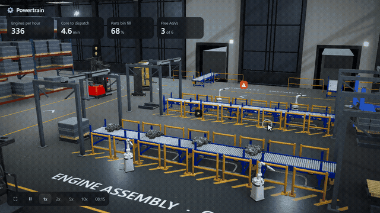

<div align="center">

<p><b>English</b> &nbsp;·&nbsp; <a href="./README.zh-CN.md">简体中文</a> &nbsp;·&nbsp; <a href="https://yeeby2019.github.io/powertrain/">Live demo</a></p>

<a href="#quick-start"></a>

<h1>Powertrain</h1>

<p><b>A browser-based digital twin of an engine-assembly plant.<br>Real SimReady models, one deterministic simulation, no pre-rendered animation.</b></p>

<p>
<a href="#requirements">Requirements</a> &nbsp;·&nbsp;
<a href="#quick-start">Quick&nbsp;start</a> &nbsp;·&nbsp;
<a href="#the-hall">The&nbsp;hall</a> &nbsp;·&nbsp;
<a href="#how-it-works">How&nbsp;it&nbsp;works</a> &nbsp;·&nbsp;
<a href="#where-it-came-from">Where&nbsp;it&nbsp;came&nbsp;from</a> &nbsp;·&nbsp;
<a href="NOTICE.md">Sources&nbsp;&amp;&nbsp;licence</a>
</p>

<p>


</p>

</div>

<br>

**Powertrain** is a browser-based digital twin of an engine-assembly plant, built with three.js.
AGVs fetch V8, V6, V12 and electric cores from a parts store and deliver them to two assembly lines;
finished batches move to a dyno-test and dispatch area. No part of the scene is a recorded animation —
every pallet, core and AGV is positioned by a seeded simulation running at a fixed 30 Hz step.

It builds on the renderer, simulation driver and camera/picking system of
[`codepawl/3d-builds`'s `works/2026-10-31-rackline`](https://github.com/codepawl/3d-builds)
("Rackline"), reworked into an engine-assembly plant with a different product, floor plan, low camera
and steel-blue palette. The README structure follows
[`head-tracked-3d`](https://github.com/YeeBy2019/head-tracked-3d).

## Requirements

| | Minimum | Recommended |
| --- | --- | --- |
| Operating system | Windows 10, macOS 12 or a modern Linux distribution — any OS with a WebGL 2 browser | — |
| Browser | Chrome / Edge 120+, Firefox 121+, Safari 17+ with WebGL 2 enabled | Latest Chrome or Edge |
| Node.js (development / build only) | 20.19+ or 22.12+ (required by Vite 8) | 22.x LTS |
| System memory | 4 GB | 8 GB or more |
| GPU / VRAM | WebGL 2 capable GPU with 2 GB VRAM; integrated GPUs should use `?quality=low` | Discrete GPU with 4 GB+ VRAM |
| Disk space | ~300 MB (206 MB of models plus dependencies) | — |

The running app needs no backend and no internet connection once the assets are present. WebGL 2 is
required; WebGL 1 is not supported.

## Quick start

```sh
python tools/fetch_assets.py      # skip if public/assets is already present
npm install
npx vite --port 5495 --strictPort
```

Open `http://localhost:5495`. Click an AGV, an assembly line, a rack row or a dock to see what it is
doing. The fetch script skips files already on disk; if `huggingface.co` is unreachable, set
`HTTPS_PROXY` / `HTTP_PROXY` before running it.

All URL options are optional:

| Option | Effect |
| --- | --- |
| `?preroll=<seconds>` | advance the simulation before the first frame (default 900) |
| `?seed=<integer>` | choose a different event sequence (default 7) |
| `?quality=low` | lower DPR, shadow size, AO resolution and framebuffer precision |
| `?dpr=<number>` | pin the device pixel ratio, e.g. `?dpr=1` |

| Symptom | Fix |
| --- | --- |
| Black canvas | check the console for a failed GLB download and re-run the fetch script |
| Lost WebGL context or a very slow first frame | append `?quality=low` |
| Clipped or harsh shading | append `?dpr=1` |

## The hall

| Zone | What happens |
| --- | --- |
| Parts store | Three rack rows hold bins of engine cores; AGVs fetch a core for a waiting batch. |
| Assembly lines | Two lines fit cores into batches; cases travel down the belt and the gantries move with them. |
| Dyno & dispatch | Finished batches are carried to two outbound doors and loaded onto trailers. |
| Inbound | Three receiving doors restock the parts store. |

Four core types flow through the hall — **V8, V6, V12 and electric** — so a selected AGV reports that
it is "Fetching a V8 core for batch 4109" rather than moving anonymous boxes. Four KPIs are read from
the simulation rather than a counter: **engines per hour**, **core-to-dispatch time**, **parts-bin
fill** and **free AGVs**. The seed is fixed (`7`), so the same `preroll` always opens on the same scene.

## Controls

No setup is needed; everything in the dock only changes how the scene is viewed.

| Input | What it does |
| --- | --- |
| **Click an AGV** | the camera follows it down the aisle; the card shows its current task |
| **Click an assembly line** | shows batches fitted and whether the line is jammed |
| **Click a rack row / dock** | shows bin occupancy or trailer loading state |
| **Drag** | orbit the hall |
| **Home button / Esc** | fly back to the overview and clear the selection |
| **Space** | pause or resume the simulation |
| **Speed buttons** | 1×, 2× or 4× simulation time |

## How it works

```
layout.js ──► sim.js ──► world.js ──► main.js ──► EffectComposer
  hall        1/30 s       GLB pools     camera       AO + bloom + grade
  geometry    fixed step   instances     picking      (renderer ACES)
```

**A simulation, not an animation.** [`src/sim.js`](src/sim.js) has no three.js and no DOM.
It advances orders, AGV routes, conveyor cases and trailer swaps in deterministic 1/30-second steps.
[`src/world.js`](src/world.js) reads that state each frame and positions pooled instances;
[`src/main.js`](src/main.js) owns the camera, picking and HUD. A given seed and `preroll`
therefore always reproduce the same day.

**SimReady GLBs, instanced.** The models come from
[`codepawl/simready-glb`](https://huggingface.co/datasets/codepawl/simready-glb) — NVIDIA SimReady
assets converted to GLB. `flattenModel` merges each model by material into a handful of geometries;
`createInstances` then draws the repeated racks, bins and cores as `InstancedMesh`. The AGV is split
into chassis, mast stage and cab with forks so the mast can actually lift.

**Scales across GPUs.** A single `?quality=low` switch lowers DPR, shadow-map size, AO resolution and
composer framebuffer precision, and a `webglcontextlost` handler falls back to it automatically.
Cloned GLB materials use `anisotropy = 8` so floor markings stay legible at the low camera angle.

## Where it came from

| | Rackline (upstream) | Powertrain (this project) |
| --- | --- | --- |
| Building | automated pallet warehouse | engine-assembly plant |
| Product | cardboard pallets | V8 / V6 / V12 / electric cores |
| Storage | full pallet racks | parts bins + core store |
| Transport | six forklifts | six AGVs |
| Flow | receive → put-away → pick → pack → ship | core supply → line assembly → dyno test → dispatch |
| Camera | high overview | low, close to the assembly line |
| Palette | warehouse amber / green | industrial steel blue |
| KPIs | pallets/hour, orders, rack fill | engines/hour, core-to-dispatch, bin fill, free AGVs |

The renderer, simulation driver and picking system are inherited from Rackline; the floor plan,
product semantics, instance pools, materials, camera, HUD and this document were rewritten for this
project.

## Tech stack

| Layer | Choice |
| --- | --- |
| Renderer | three.js 0.186.1, WebGL 2 |
| Models | 60 SimReady GLBs (CC BY 4.0), 206 MB, fetched from `codepawl/simready-glb` |
| Post | `postprocessing` 6.39.5 (bloom, grade, SMAA) + `n8ao` 1.10.1; tone mapping in three.js |
| Environment | `empty_warehouse_01` 2K HDRI and worn-concrete floor maps, Poly Haven (CC0) |
| Build | Vite 8.3.4, plain JavaScript, no test framework |

## Limits

- **Not a physics engine.** AGVs follow precomputed, corner-rounded lane paths with lane-clearance
  checks; cases and cores are pooled instances. This is a logistics simulation, not rigid-body dynamics.
- **One hall, one seed.** The layout and the four product types are fixed in code; changing the
  building means editing `layout.js`, `world.js` and `sim.js` together.
- **Models are third-party.** The GLBs are CC BY 4.0 and must keep their attribution — see
  [`NOTICE.md`](NOTICE.md).

## Project layout

```
powertrain/
  README.md, README.zh-CN.md  this document
  NOTICE.md                   sources, licences and provenance
  LICENSE                     MIT, inherited from the upstream code
  media/preview.gif           the demo GIF above
  index.html                  canvas, HUD, dock
  package.json                dependencies and scripts
  src/
    main.js                   boot, camera, picking, KPIs, post-processing
    world.js                  GLB loading, flattening, instance pools, materials
    sim.js                    seeded fixed-step simulation (no DOM, no three.js)
    layout.js                 hall geometry, lanes and stations
    styles.css                steel-blue UI
  public/
    assets/                   60 SimReady GLBs (fetched, not hand-authored)
    env/                      Poly Haven HDRI
    textures/                 Poly Haven floor maps
  tools/
    fetch_assets.py           downloads the GLBs and thumbnails
    film.mjs                  records the demo GIF
    measure.mjs               measures a model's bounding box
    gapcheck.mjs              checks AGV separation over a run
```

## Licence

**The code is MIT-licensed**, inherited from the upstream Rackline project. **The models are NVIDIA
SimReady assets under CC BY 4.0**, and the HDRI/floor textures are Poly Haven CC0. See
[`NOTICE.md`](NOTICE.md) for full provenance and attribution requirements.
