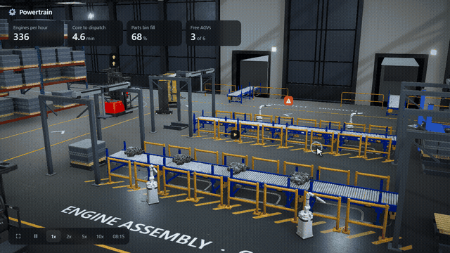

<div align="center">

<p><a href="./README.md">English</a> &nbsp;·&nbsp; <b>简体中文</b> &nbsp;·&nbsp; <a href="https://yeeby2019.github.io/powertrain/">在线预览</a></p>

<a href="#快速开始"></a>

<h1>Powertrain</h1>

<p><b>浏览器端的发动机装配车间数字孪生。<br>真实的 SimReady 模型，一套确定性仿真，没有预录动画。</b></p>

<p>
<a href="#运行需求">运行需求</a> &nbsp;·&nbsp;
<a href="#快速开始">快速开始</a> &nbsp;·&nbsp;
<a href="#车间">车间</a> &nbsp;·&nbsp;
<a href="#工作原理">工作原理</a> &nbsp;·&nbsp;
<a href="#来源">来源</a> &nbsp;·&nbsp;
<a href="NOTICE.md">素材与许可</a>
</p>

<p>


</p>

</div>

<br>

**Powertrain** 是一个用 three.js 做的浏览器端数字孪生：发动机装配车间。AGV 从零件库取出 V8、V6、V12 和电动发动机核心，送到两条装配线；装好的批次再运往台架测试与发运区。场景里没有一段预录动画——每个托盘、每台核心、每辆 AGV 都由一套固定种子、固定 30 Hz 步长的仿真摆放。

本项目改写自 [`codepawl/3d-builds` 的 `works/2026-10-31-rackline`](https://github.com/codepawl/3d-builds)（Rackline，2026-10-31）的渲染器、仿真驱动与相机/拾取系统，重新设计为发动机装配车间：产品、平面布局、机位与配色都不同。README 的结构参考了 [`head-tracked-3d`](https://github.com/YeeBy2019/head-tracked-3d)。

## 运行需求

| | 最低 | 推荐 |
| --- | --- | --- |
| 操作系统 | Windows 10、macOS 12 或现代 Linux 发行版——任何能运行 WebGL 2 浏览器的系统 | — |
| 浏览器 | Chrome / Edge 120+、Firefox 121+、Safari 17+，需启用 WebGL 2 | 最新版 Chrome 或 Edge |
| Node.js（仅开发与构建需要） | 20.19+ 或 22.12+（Vite 8 的要求） | 22.x LTS |
| 系统内存 | 4 GB | 8 GB 及以上 |
| GPU / 显存 | 支持 WebGL 2、2 GB 显存；集成显卡请使用 `?quality=low` | 独立显卡，4 GB 及以上显存 |
| 磁盘空间 | 约 300 MB（206 MB 模型 + 依赖） | — |

素材就绪后，核心数字孪生无需后端、也无需联网。可选的自然语言控制台默认以 Demo 模式离线运行；Live 模式需要你自己的 API Key，且仅用于本地开发。必须使用 WebGL 2，不支持 WebGL 1。

## 快速开始

```sh
python tools/fetch_assets.py      # 如果 public/assets 已经存在，可跳过
npm install
npx vite --port 5495 --strictPort
```

打开 `http://localhost:5495`。点击 AGV、装配线、货架排或月台，可以看到它正在做什么。下载脚本会跳过已有文件；如果机器无法直连 `huggingface.co`，在运行前设置 `HTTPS_PROXY` / `HTTP_PROXY`。

所有 URL 参数都是可选的：

| 参数 | 作用 |
| --- | --- |
| `?preroll=<秒数>` | 在第一帧前先推进仿真（默认 900） |
| `?seed=<整数>` | 换一套事件排布（默认 7） |
| `?quality=low` | 降低 DPR、阴影、AO 分辨率和帧缓冲精度 |
| `?dpr=<数值>` | 固定设备像素比，例如 `?dpr=1` |
| `?llm=demo\|live` | 本次会话强制控制台模式（Demo 无需 Key） |

## 自然语言控制台（仅本地）

右上角的对话气泡按钮会打开控制台。用日常英文下指令即可：派 AGV 去取发动机核心、查看实时数据、把镜头聚焦到某台设备、返回总览、调整仿真速度。常用的示例指令点一下就能填入。

默认处于 **Demo** 模式，无需 Key、无需联网就能识别常见指令。想用真实模型驱动，打开设置齿轮，选择服务商（OpenAI、DeepSeek 或任意 OpenAI 兼容接口），填入自己的 API Key，再切到 **Live**。Key 只保存在你的浏览器里，仅经本地开发服务器转发，不会写进文件，也不会从线上演示站发出。该控制台是本地开发功能，不包含在 GitHub Pages 构建中。

| 现象 | 处理 |
| --- | --- |
| 画面全黑 | 打开控制台查看是否有 GLB 下载失败，重跑下载脚本 |
| WebGL 上下文丢失或首帧很慢 | 地址后加 `?quality=low` |
| 有裁切或生硬的明暗 | 加 `?dpr=1` |

## 车间

| 区域 | 发生的事 |
| --- | --- |
| 零件库 | 三排货架存放装有发动机核心的料箱；AGV 为等待中的批次取核心 |
| 装配线 | 两条线把核心装入批次；料盒沿传送带流动，龙门架随之移动 |
| 台架与发运 | 完成的批次被送往两个出货门，装上拖车 |
| 入库 | 三个收货门为零件库补货 |

车间里流转四种核心——**V8、V6、V12 和电动**——于是选中的 AGV 会报告它正在"Fetching a V8 core for batch 4109"，而不是搬着无名纸箱。四个 KPI 都是仿真算出来的，不是计数器：**每小时发动机数**、**核心到发运时间**、**料箱填充率**和**空闲 AGV 数**。种子固定（`7`），因此同一个 `preroll` 打开的永远是同一个现场。

## 操作

无需任何设置，底部控制栏只改变观看方式。

| 操作 | 说明 |
| --- | --- |
| **点击 AGV** | 相机沿巷道跟随它，卡片显示当前任务 |
| **点击装配线** | 显示本批次已装入数，以及是否堵线 |
| **点击货架排 / 月台** | 显示料箱占用或拖车装载状态 |
| **拖拽** | 环绕车间 |
| **Home 按钮 / Esc** | 飞回总览并清除选中 |
| **空格** | 暂停或继续仿真 |
| **速度按钮** | 1×、2× 或 4× 仿真时间 |

## 工作原理

```
layout.js ──► sim.js ──► world.js ──► main.js ──► EffectComposer
  厂房         1/30 秒     GLB 实例池    相机         AO + 辉光 + 调色
  几何         固定步长                   拾取        （色调映射在 renderer）
```

**是仿真，不是动画。** [`src/sim.js`](src/sim.js) 不含 three.js，也不碰 DOM。它按确定性的 1/30 秒步长推进订单、AGV 路线、传送带料盒和拖车更换。[`src/world.js`](src/world.js) 每帧读取这份状态，摆放池化的实例；[`src/main.js`](src/main.js) 负责相机、拾取和 HUD。因此给定种子和 `preroll`，永远复现同一天。

**SimReady GLB，实例化绘制。** 模型来自 [`codepawl/simready-glb`](https://huggingface.co/datasets/codepawl/simready-glb)，是转成 GLB 的 NVIDIA SimReady 资产。`flattenModel` 按材质把每个模型合并成少量几何体，`createInstances` 再把重复的货架、料箱和核心画成 `InstancedMesh`。AGV 被拆成底盘、门架升降段和带货叉的驾驶室，门架因此能真的升降。

**适配不同显卡。** 一个 `?quality=low` 开关即可降低 DPR、阴影贴图、AO 分辨率和合成器帧缓冲精度，`webglcontextlost` 处理器还会自动回退到该模式。克隆出来的 GLB 材质统一设 `anisotropy = 8`，低机位下地面标识依然清晰。

## 来源

| | Rackline（上游） | Powertrain（本项目） |
| --- | --- | --- |
| 厂房 | 自动化托盘仓库 | 发动机装配车间 |
| 产品 | 纸箱托盘 | V8 / V6 / V12 / 电动核心 |
| 存储 | 满载托盘货架 | 零件料箱 + 核心库 |
| 运输 | 六辆叉车 | 六台 AGV |
| 流程 | 收货 → 上架 → 拣选 → 打包 → 发货 | 核心供应 → 上线装配 → 台架测试 → 发运 |
| 机位 | 高位总览 | 压低，贴近装配线 |
| 配色 | 仓库琥珀 / 绿 | 工业钢蓝 |
| KPI | 每小时托盘、订单、货架填充 | 每小时发动机、核心到发运、料箱填充、空闲 AGV |

渲染器、仿真驱动和拾取系统继承自 Rackline；平面布局、产品语义、实例池、材质、相机、HUD 和本文档均为本项目重写。

## 技术栈

| 层 | 选择 |
| --- | --- |
| 渲染 | three.js 0.186.1，WebGL 2 |
| 模型 | 60 个 SimReady GLB（CC BY 4.0），206 MB，取自 `codepawl/simready-glb` |
| 后期 | `postprocessing` 6.39.5（辉光、调色、SMAA）+ `n8ao` 1.10.1；色调映射在 three.js |
| 环境 | Poly Haven 的 `empty_warehouse_01` 2K HDRI 与磨损混凝土地面贴图（CC0） |
| 构建 | Vite 8.3.4，原生 JavaScript，无测试框架 |

## 限制

- **不是物理引擎。** AGV 沿预先算好、圆角化的车道路径行驶，并做让行检查；料盒和核心是池化实例。这是物流仿真，不是刚体动力学。
- **单一车间、单一种子。** 布局和四种产品写死在代码里；改厂房需要同时改 `layout.js`、`world.js` 和 `sim.js`。
- **模型是第三方素材。** GLB 为 CC BY 4.0，必须保留署名——见 [`NOTICE.md`](NOTICE.md)。

## 项目结构

```
powertrain/
  README.md, README.zh-CN.md  本文档
  NOTICE.md                   来源、许可与出处
  LICENSE                     MIT，继承自上游代码
  media/preview.gif           上方的演示动图
  index.html                  canvas、HUD、控制栏
  package.json                依赖与脚本
  src/
    main.js                   启动、相机、拾取、KPI、后期
    world.js                  GLB 加载、合并、实例池、材质
    sim.js                    确定性定步长仿真（无 DOM、无 three.js）
    layout.js                 厂房几何、车道与工位
    styles.css                钢蓝 UI
  public/
    assets/                   60 个 SimReady GLB（下载所得，非手写）
    env/                      Poly Haven HDRI
    textures/                 Poly Haven 地面贴图
  tools/
    fetch_assets.py           下载 GLB 与缩略图
    film.mjs                  录制演示动图
    measure.mjs               测量模型包围盒
    gapcheck.mjs              检查一段时间内的 AGV 间距
```

## 许可

**代码采用 MIT 许可**，继承自上游 Rackline 项目。**模型为 NVIDIA SimReady 资产，采用 CC BY 4.0**；HDRI 与地面贴图来自 Poly Haven，采用 CC0。完整出处与署名要求见 [`NOTICE.md`](NOTICE.md)。
